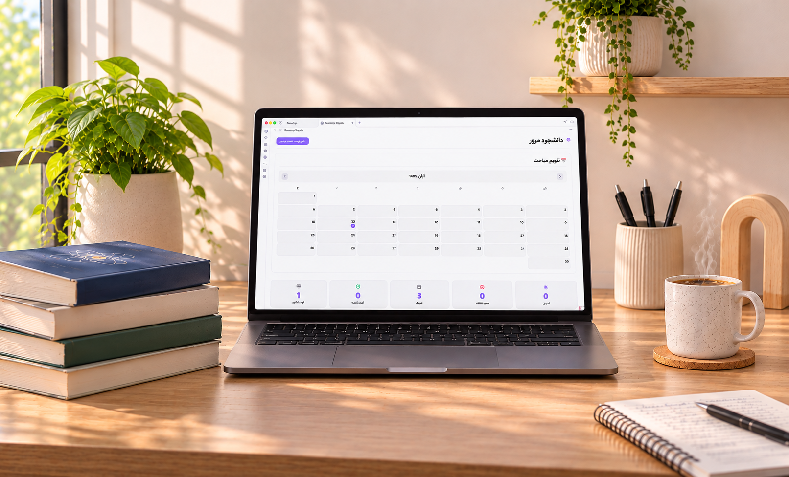

# 🚀 Recovery Engine Study

**دستیار هوشمند مدیریت و مرور درسی در Obsidian**

📚 اگر اهل مطالعه و یادگیری هستید و دغدغه‌ی اصلی‌تان «فراموش نکردن مطالب» است، Recovery Engine Study دقیقاً همان ابزاری است که به آن نیاز دارید. این افزونه یک سیستم مدیریت مرور قدرتمند و در عین حال ساده است که بار برنامه‌ریزی را از دوش شما برمی‌دارد.

---

## 🌟 چه چیزهای جدیدی اضافه شده؟

- 📱 **پشتیبانی کامل از موبایل** (اندروید و iOS): حالا می‌توانید در هر کجا و با هر دستگاهی مرورهای خود را مدیریت کنید.
- 📅 **تقویم شمسی** در داشبورد و فرم ثبت: مشاهده‌ی تعداد مباحث هر روز و انتخاب تاریخ از تقویم شمسی.
- 🔄 **مدیریت تعویق**: مرورها را به روز بعد موکول کنید و هر زمان خواستید آن را لغو کنید.
- 🎨 **رابط کاربری کاملاً بازطراحی‌شده**: طراحی فلت، مدرن، راست‌چین و کاملاً هماهنگ با تم Obsidian.
- ✅ **استانداردسازی ساختار DOM** و رفع خطاهای ESLint: کدی تمیزتر و پایدارتر.

---

## ✨ ویژگی‌های کلیدی

- ⏰ **زمان‌بندی کاملاً قابل تنظیم**: ساخت چرخه‌های مرور سفارشی (روزانه، هفتگی، ماهانه و بلندمدت).
- 📊 **داشبورد اختصاصی**: نمایش یک‌جای مرورهای امروز، عقب‌افتاده‌ها، آینده و آمار عملکرد.
- ✅ **چک‌لیست اختصاصی**: تعریف چک‌لیست‌های مجزا برای هر درس و تیک زدن آن‌ها در حین مرور.
- 📂 **اتصال به منابع**: لینک دادن هر مبحث به فایل‌ها و یادداشت‌های شما در والت (با پشتیبانی از بلاک‌های خاص).
- 💾 **پشتیبان‌گیری و بازیابی**: خروجی گرفتن از تمام اطلاعات در قالب JSON.

---

## 📦 نصب

### روش اول (پیشنهادی)
از داخل Obsidian:
**Settings → Community Plugins → Browse → Recovery Engine Study**

### روش دوم (دستی)
فایل‌های `main.js`، `manifest.json` و `styles.css` را از صفحه‌ی Releases دانلود و در پوشه‌ی `.obsidian/plugins/recovery-engine-study/` جایگزین کنید.

---

## 🛠 توسعه و مشارکت

این افزونه با عشق برای دانشجویان و دانش‌پژوهان فارسی‌زبان ساخته شده است. اگر ایده، پیشنهاد یا نقدی برای بهتر شدنش دارید، خوشحال می‌شوم بشنوم.

- **GitHub:** [sedghimohammadamin/recovery-engine-v2](https://github.com/sedghimohammadamin/recovery-engine-v2)
- **Issue Tracker:** برای گزارش باگ یا درخواست قابلیت جدید، از بخش Issues استفاده کنید.

---

## 📄 لایسنس

این پروژه تحت لایسنس MIT منتشر شده است.

**ساخته‌شده برای مطالعه‌ی بهتر، مرور هوشمندتر و یادگیری ماندگارتر. 🌱**

---

# Recovery Engine Study (English)

**An intelligent study review management system for Obsidian**

Recovery Engine Study is a simple yet powerful review management system that takes the burden of scheduling off your shoulders.

## Features

- 📱 Mobile support (Android and iOS)
- 📅 Jalali calendar in dashboard and add-item form
- ⏰ Fully customizable review scheduling (daily, weekly, monthly, long-term)
- 📊 Dedicated dashboard with today's, overdue, and upcoming reviews
- ✅ Per-subject checklists
- 📂 Source linking to vault files and notes
- 🔄 Snooze management
- 💾 Backup and restore via JSON

## Installation

From inside Obsidian: **Settings → Community Plugins → Browse → Recovery Engine Study**

Or manually copy `main.js`, `manifest.json`, and `styles.css` into `.obsidian/plugins/recovery-engine-study/`.

## Development

Run `npm install` then `npm run build`.

## License

MIT
